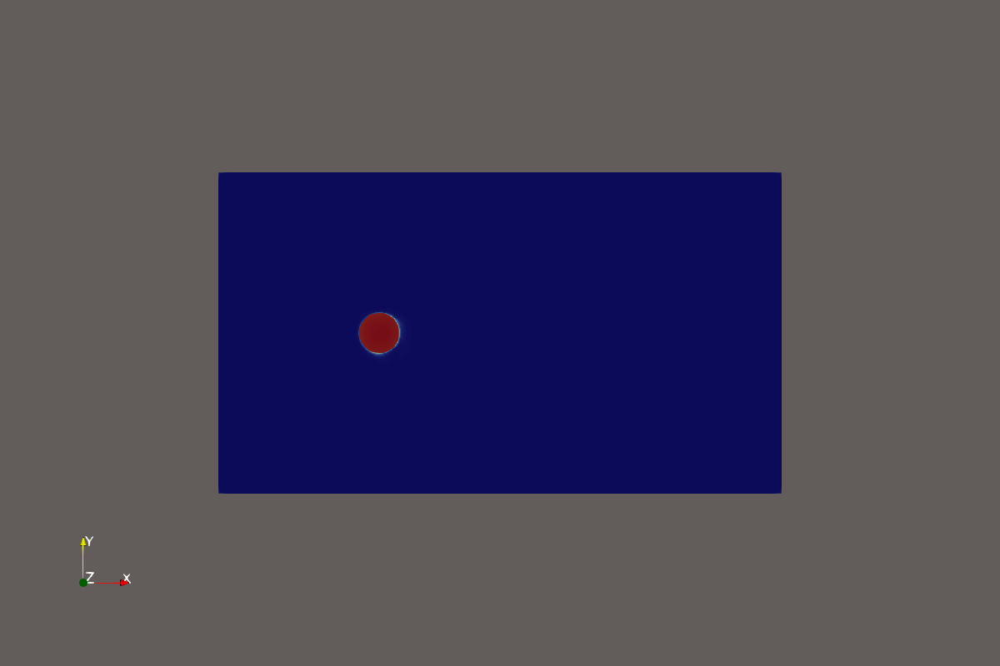

# OpenFOAM Workbench (dsh-openfoam-workbench)

Native **DeepSeek Harness** plugin for OpenFOAM: 61 tools and 11 on-demand skills
covering case scaffolding, inspection, solver development, meshing, multi-region CHT runs,
durable background jobs, off-screen renders, paper reproduction and an
experience library. The agent gets one coherent surface — a thin always-on core
prompt (`CORE.md`), procedural skills, and tools that enforce the conventions
instead of asking the model to remember them.

## Status

Implemented and validated on **OpenFOAM 14** (org, modular solvers),
**OpenFOAM v2606** (com, multi-region tutorials) and **ParaView 6.2.0**:

**v0.9.5 · 62 tools · 11 skills · 110 tests**

Pre-1.0: the tool set and the on-disk conventions may still change between
minor versions.

## Requirements

- **DeepSeek Harness** `>=0.2.2-rc.1` — declared as `engines.dsh`, so the
  installer refuses an older host instead of mounting a plugin it cannot support.
- **OpenFOAM** installed locally (org, e.g. `openfoam14`, and/or com, `vYYMM`);
  the plugin drives it in subprocesses and never vendors it.
- **ParaView 6.x** with `pvpython` for renders and `-help` checks — optional:
  everything else works without it.
- A POSIX shell (`bash -lc`) on Linux or macOS. Windows/WSL is not tested.

## Supported versions

Tested end to end (mesh → solver → verifier) on **OpenFOAM 14** (org) and
**OpenFOAM v2606** (com). The two branches differ in ways the tools follow:

| Aspect | org 14 | com v2606 |
|---|---|---|
| incompressible entry | `foamRun` + `solver incompressibleFluid;` | no `foamRun`: `simpleFoam`, `pimpleFoam`, … |
| multi-region | `regionSolvers` + `foamMultiRun` | `regionProperties` groups, `restore0Dir`, `0.orig/` |
| case files | `physicalProperties`, `momentumTransport` | `transportProperties`, `turbulenceProperties` |
| initial fields | `0/` | `0.orig/` (and `0_orig/`, both accepted) |

Other versions and branches are **best effort**. Discovery, the doctor and the
scaffold accept both layouts and pick the org/com form from `distribution`, but
a fork with different solver names, `regionProperties` verbs or field files will
surface as a tool hint or a doctor finding rather than a silently wrong
dictionary. Turbulent, compressible and CHT setups are not generated at all —
use `openfoam_find_tutorial` + `openfoam_clone_tutorial` for those.

## Install

From the marketplace (once the plugin is listed):

```text
Discover → search "OpenFOAM" → Install → restart DSH
```

From a local checkout:

```bash
dsh plugin install /path/to/dsh-openfoam-workbench
```

**Zero configuration.** The bundle ships no paths: at startup the plugin scans
`/opt`, `/usr/lib/openfoam`, `/usr/local` and `~/OpenFOAM` for directories that
contain `etc/bashrc` (org `openfoam14` and com `vYYMM` are told apart by name),
and looks for ParaView in `/opt` and on `PATH`. `openfoam_env_check` shows what
was found; `defaultDistribution` picks the install used when a tool is called
without `distribution=`.

Everything is also editable from **Settings → Plugins → OpenFOAM Workbench** once
DSH has mounted the plugin (`lib/settings-schema.js` exports a native schemastery
`Config`: `foamRoots`, `caseRoots`, `paraviewPython`, `language`, `scaleAskAbove`,
`logTailBytes`, `extraCommands`, …). The schema borrows the schemastery copy that
ships with DSH, so the bundle keeps zero npm dependencies.

Override in your **profile** patch (not in this repository) when you prefer YAML
or when discovery gets a path wrong:

```yaml
- id: openfoam-workbench
  name: '@yakovlev-i-a/dsh-openfoam-workbench'
  config:
    foamRoots: { org: /opt/openfoam14, com: /usr/lib/openfoam/openfoam2606 }
    paraviewPython: /opt/paraview/bin/pvpython
    caseRoots: [/path/to/cases]   # relative case paths resolve from cwd otherwise
    language: ru                  # '' = OS locale, 'ru'/'en'/... or a name forces one
```

Restart DSH after install or after changing the patch.

## Update

DSH imports plugin code at boot, so a running instance keeps the version it
started with:

```bash
# linked install ("...": "link:/path/to/dsh-openfoam-workbench") — no reinstall:
git -C /path/to/dsh-openfoam-workbench pull --ff-only
# package install (github:, npm tarball):
dsh plugin --profile web update @yakovlev-i-a/dsh-openfoam-workbench
# then restart the host that boots the profile:
dsh web
```

`openfoam_env_check`/`openfoam_version_info` return `plugin.version` from
`package.json`, so a stale in-memory copy is visible without guessing.

## Multiple distributions

Several OpenFOAM installations can coexist:

```yaml
foamRoots:
  org: /opt/openfoam14
  com: /usr/lib/openfoam/openfoam2606
defaultDistribution: org
```

`openfoam_env_check` reports **every** configured distribution. `openfoam_run`,
`openfoam_run_solver_async`, `openfoam_solver_build`, `openfoam_dry_compile`,
`openfoam_solver_smoke` and `openfoam_version_info` take a `distribution` argument
(`org` / `com`) and otherwise use `defaultDistribution`.

## Case conventions

Two conventions are enforced by the tools, not by the prompt:

- **`<case-dir-name>.foam`** — `clone_tutorial`, `mesh_plan`, `run`,
  `run_solver_async` and `render` create the ParaView entry file named after the
  case directory (`case.foam` is *not* accepted as a substitute). `inspect_case`
  reports `foamFile`, `list_cases` reports whether it exists.
- **Relative paths** — a relative `casePath` resolves against the first
  `caseRoots` entry (the session working directory is only the fallback when
  `caseRoots` is empty); absolute paths always work. Run records and logs live
  next to their case in `<case>/.openfoam-runs`, unless `runsDir` pins a
  directory.
- **Geometry-scale gate** — `mesh_plan` and `check` compare the bounding box with
  `scaleAskAbove` (default `0.1` m). Above it the result carries a
  language-neutral `needs_input` payload — `{kind, ask, data, options: [{id, label}]}`
  — rendered as a QUESTION block; the agent asks with `ask_user_question` in the
  user's language (CORE.md `{{language}}`), translating the option labels, and
  continues only after the answer. Set `scaleAskAbove: 0` to disable.

## Multi-region (CHT) cases

A multi-region case (`foamMultiRun`, `chtMultiRegionFoam`, `system/<region>/...`)
is understood end to end, not treated as a broken single-region case:

```text
inspect_case        -> regions, regionSolvers, per-region fields/patches
read_dict           -> file="fluid/fvSchemes", "system/fluid/...", "0/fluid/T", or region="fluid"
mesh_verify         -> checkMesh -region <r> for every region, verdict from checkMesh itself
run / run_async     -> mpirun -np N foamMultiRun (whitelisted launcher)
run_progress        -> t, steps, s/step, ETA from a multi-region/parallel log
solve_verify        -> RUNNING | STALLED | finished, no false divergence from the sigFpe banner
render              -> every mesh region (or region="fluid"), errors on an empty scene
```

`mesh_verify` takes its verdict from what checkMesh prints (`Mesh OK.` /
`Failed N mesh checks.`) and reports the stricter workbench thresholds
(aspect ratio, non-orthogonality, skewness) as warnings. `check` (the doctor)
is region-aware too: it reads `system/<r>/fvSchemes|fvSolution`, `0/<r>/*` and
`constant/<r>/*`, tags every finding with its region, and accepts
`region="<name>"` to narrow the report. `checkMesh -allRegions`
does not exist in OpenFOAM.org — the per-region call is the only honest one.

## What you get

- **Tools** (`openfoam_*`, 61): env/version, tutorials, solver clone/build/smoke,
  durable async runs (`run_solver_async` → `run_list` / `solver_status`),
  run progress/ETA (`run_progress`), meshing (STL → blockMesh/snappy → checkMesh),
  render (inline PNG, multi-region), verification (`solve_verify`, `mesh_verify`),
  case editing (`dict_set`, `clean`), doctor checks, diagnostics, papers,
  experience, and a usage self-audit (`usage_report`). Verdicts on huge logs read
  only the tail (`logTailBytes`, 4 MB by default) instead of the whole file.
- **Skills** (`SKILL.md`, load on demand, 11): case-builder, **cht** (multi-region
  conjugate heat transfer), solver-development, code-modify, meshing,
  mesh-independence, stats, viz, analyze, paper-reproduction, self-evolution.
  A test keeps every referenced tool registered and the always-on catalog under 4 KB.
- **Presentation**: inline render images (`image` blocks), table renders for
  `check` / `run_list` / `mesh_verify` / `env_check` / `list_cases` /
  `run_progress` / `solve_verify` / `usage_report`, compact JSON for large
  payloads, and a `QUESTION` block whenever a tool needs a human decision
  (`needs_input`). In the Web UI the call summary of every `openfoam_*` row
  (`openfoam_x · …`) is blue, `#3b518c` on light and `#9db4e0` on dark
  (`client.js`, the browser half of this bundle; no per-tool registration).

## Screenshots



`openfoam_render` on `multiRegion/CHT/coolingCylinder2D` — 3045 cells, both
regions, temperature. The render reads only the case directory (no GUI).

## Security

The plugin **runs local OpenFOAM programs with the privileges of your OS user**
and is **not a sandbox**: a solver or `wmake` call has the same access as a shell
started by you.

What it does to make that safe:

- only whitelisted applications run (`BASE_APPS` plus the `extraCommands`
  config), and a command containing shell metacharacters (`;`, `|`, `$()`,
  backticks, newlines) is refused before anything is spawned;
- the shell is always a **static script**: the bashrc, the working directory, the
  log path and the command arrive as argv / positional parameters, never as text
  spliced into the script, so a path containing quotes, `$()`, backticks or
  spaces cannot become shell code (`lib/runtime.js`, `FOAM_RUN_SCRIPT`);
- child processes get `stdin: ignore` and never inherit a terminal;
- `clean` is a dry run by default, `dict_set` replaces one entry atomically and
  keeps a `.bak`, and the source tools only read the OpenFOAM installation.

No credentials ship with this repo. Put any API keys in DSH's `credentials`
service, never in `settings.json` or in the bundle.

## Docs

- [CORE.md](./CORE.md) — the always-on core prompt. It is read at runtime (the
  section text is a function, re-evaluated on every model step), so editing this
  file changes the agent on the next message, without restarting DSH. Keep it
  under 3 KB: a test fails if it grows past the budget or loses a routing marker.
  The `{{language}}` placeholder is filled from the `language` config or the OS
  locale, so one file serves every language.
  The iron rules separate *verifiable facts* (the case, the installed OpenFOAM,
  a run result — check with a tool) from *conceptual answers* (`why does the
  pressure equation carry this correction?` — answer directly and cite the
  source when the version matters), so the agent does not call a tool just to
  satisfy a rule.
- [NOTICE](./NOTICE) / [LICENSE](./LICENSE) — attribution (Apache-2.0 + MIT).
- [market/index.json](./market/index.json) — the format-1 marketplace index
  pinned to a release commit (`node scripts/make-market-index.mjs --commit <sha>
  --out market/index.json`); host it over https and add that URL in Discover.

## Layout

```
lib/index.js       # entry: apply() mounts core + skills + tool groups (~50 lines)
lib/core.js        # always-on prompt section, read from CORE.md on every assembly
lib/skills.js      # reads skills/*/SKILL.md and registers the catalog
lib/runtime.js     # process/paths/runs helpers + config defaults (deps for tools)
lib/knowledge.js   # solver classification + error patterns + diagnosis
lib/presentation.js# pvpython renders, inline images, tool-call cards, tables
lib/registry.js    # registration choke point: render, strict schema, telemetry, safety
lib/of-engine.js   # OpenFOAM dict parser + 31 silent-failure rules (MIT)
lib/of-case.js     # multi-region model: regions, dict paths, command whitelist, progress
lib/meshlib.js     # STL/geometry helpers + blockMesh/snappy plan writer
lib/caselib.js     # four-step contract extraction, case facts, contract audit
lib/buildlib.js    # Make/files parsing + first compiler error
lib/paperlib.js    # PDF/paper extraction helpers
lib/explib.js      # experience cards + learned error patterns
lib/tools/*.js     # one factory per group: ({cfg, attachImage}) => tools (61 total)
skills/            # 11 × SKILL.md (progressive disclosure)
test/              # 60 tests: engine, tools, registry, skills, case model, inventory, log tail
locale/            # en/ru plugin-card strings
icon.png           # plugin icon (512×512 PNG, < 256 KiB)
```

## Prior art & acknowledgements

The plugin is its own implementation: a Cordis bundle with its own tool layer,
runtime, multi-region case model, presentation, tests and prompt design. Two
parts nevertheless carry lineage, stated here precisely:

- **Dictionary parser and doctor checks** — `lib/of-engine.js` is a port of
  [dsh-openfoam-doctor](https://github.com/bushizhanghan/dsh-openfoam-doctor)
  (MIT): the OpenFOAM dictionary parser, the silent-failure rules and the
  checkMesh / run-log parsers. This plugin extends it (region-aware checks, 31
  rules, fixes) and ships its license in `licenses/`.
- **Experience format and operation coverage** — the experience-card schema
  (`title / domain / triggers / solver / physics / recipe / key_params /
  verify_seq / pitfalls`) and the overall "inspect → plan → run → verify" tool
  coverage were inspired by [NullFlux / CFDriver](https://github.com/LZF1111/nullflux)
  (Apache-2.0). No source files were copied; the code, architecture and
  descriptions are original.
- **Skill protocols** — the mesh-independence procedure (STEPS A–E), the
  numerical-stats patterns and the PROCEED / REVISE / RERUN decision taxonomy
  were adapted from
  [AI-CFD-Scientist `cfd-skills`](https://github.com/csml-rpi/AI-CFD-Scientist/tree/main/cfd-skills).
  The wording lives in `skills/` and was rewritten for this plugin.

OpenFOAM itself is not redistributed: the plugin drives the user's installed
OpenFOAM (GPL-3.0) in subprocesses.
